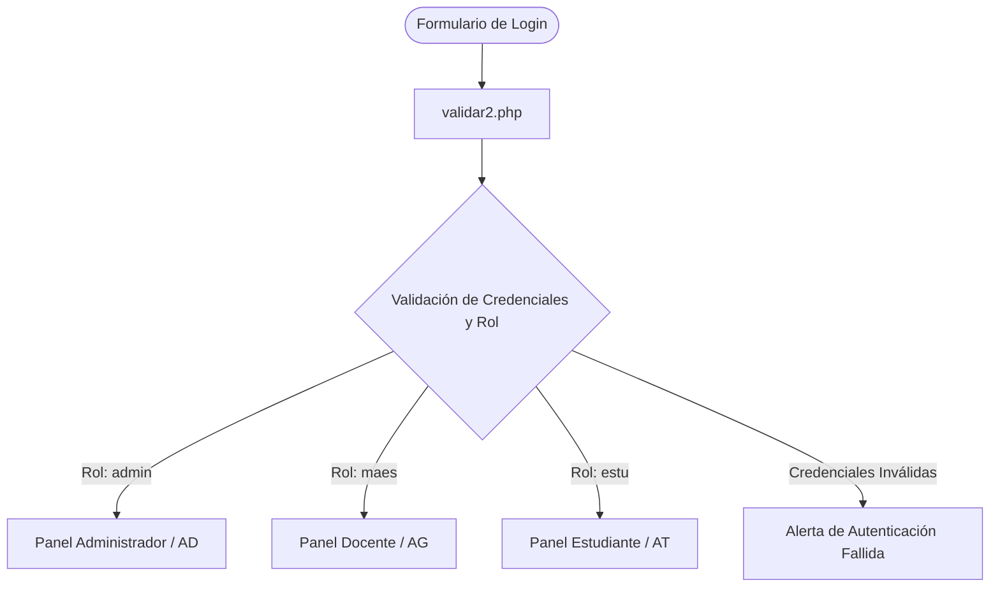

<p align="center">
  
</p>

<h1 align="center">TecnoPrector</h1>

<p align="center">
  <strong>Plataforma Web Educativa, Interactiva y Comunitaria</strong><br>
  <em>Impulsando el acceso al conocimiento, la disciplina y la innovación académica para jóvenes y estudiantes.</em>
</p>

<p align="center">
  
  
  
  
  
  
</p>

---

## 📖 Tabla de Contenidos

1. [Acerca del Proyecto](#-acerca-del-proyecto)
2. [Características Principales](#-características-principales)
3. [Módulos del Sistema](#-módulos-del-sistema)
   - [Portal Principal](#1-portal-principal-landing-page)
   - [Gestión de Clases y Asignaturas](#2-gestión-de-clases-y-asignaturas)
   - [Ecosistema de Servicios](#3-ecosistema-de-servicios-tecnoprector)
   - [Sistema de Autenticación y Control de Roles](#4-sistema-de-autenticación-y-control-de-roles)
4. [Estructura del Repositorio](#-estructura-del-repositorio)
5. [Tecnologías Utilizadas](#-tecnologías-utilizadas)
6. [Instalación y Configuración Local](#-instalación-y-configuración-local)
7. [Cuentas de Prueba](#-cuentas-de-prueba)
8. [Créditos y Equipo de Desarrollo](#-créditos-y-equipo-de-desarrollo)
9. [Licencia](#-licencia)

---

## 🌟 Acerca del Proyecto

**TecnoPrector** es una plataforma educativa integral concebida y desarrollada por un equipo juvenil de la **Institución Educativa Bravo Márquez**. Su objetivo principal es cerrar brechas de acceso a la educación formal y complementaria, ofreciendo un entorno digital dinámico, accesible y enriquecedor para jóvenes y estudiantes.

La plataforma no se limita a contenidos curriculares tradicionales; integra formación en valores, desarrollo de disciplinas personales, orientación vocacional, técnicas de estudio efectivas y áreas de esparcimiento lúdico-pedagógico para brindar una experiencia de aprendizaje completa y equilibrada.

> *"En el emocionante mundo de la educación se encuentra la llave que abre las puertas del conocimiento, el poder de transformar vidas y el camino hacia un futuro brillante."* — **TecnoPrector Team**

---

## 🚀 Características Principales

- **Gestión Multi-Rol**: Paneles diferenciados para **Administradores**, **Docentes/Maestros** y **Estudiantes** con control de sesiones y permisos.
- **Catálogo Integral de Cursos**: Organización por niveles académicos (Primaria, Secundaria, Universidad y Cursos Extracurriculares).
- **Entorno Lúdico-Pedagógico (Prector Games)**: Suite de 9 mini-juegos web para estimular el razonamiento lógico, agilidad mental y destreza motriz durante pausas activas.
- **Biblioteca Virtual**: Repositorio digital de literatura, manuales y lecturas académicas.
- **Prector Streaming**: Centro multimedia para visualización de conferencias, clases magistrales y contenido audiovisual formativo.
- **Herramientas de Crecimiento Personal**:
  - Módulo interactivo de **Técnicas de Estudio**.
  - Asesoría y guías de **Orientación Vocacional**.
  - Integración con simuladores interactivos científicos (PHET).
- **Proyectos de Emprendimiento e Impacto**: Espacio para visibilizar iniciativas como el proyecto ecológico institucional *"Jardín del Éden"* y alianzas formativas como *"AtomRupture"*.
- **Interfaz Moderna y Responsiva**: Diseño interactivo con soporte de modo oscuro/claro, fondos dinámicos en video, tipografías modernas y transiciones fluidas.

---

## 🧩 Módulos del Sistema

### 1. Portal Principal (Landing Page)
- Acceso directo mediante [`index_pagina.html`](./index_pagina.html).
- Carrusel de novedades y presentación de la propuesta de valor educativa.
- Muestrario de asignaturas destacadas (Matemáticas, Ciencias Naturales, Artes Gráficas, Idiomas).
- Sistema de captura de suscripción para visitantes y boletines informativos ([`visitantes.php`](./visitantes.php)).
- Enlaces rápidos de navegación, proyectos y contacto institucional.

### 2. Gestión de Clases y Asignaturas
- **Catálogo de Grados y Cursos** ([`grados/`](./grados/)): Rutas formativas especializadas en Ciencias, Matemáticas, Tecnología, Lengua Castellana, Inglés, Ética, Ciencias Sociales y Religión.
- **Inscripción de Estudiantes a Clases** ([`formularios/form_clases/`](./formularios/form_clases/)): Registro de alumnos directamente vinculado a la base de datos para áreas específicas.
- **Explorador Visual de Materias** ([`Asignaturas_clases/`](./Asignaturas_clases/) y [`clases/`](./clases/)): Tarjetas informativas con tutores asignados y número de sesiones.

### 3. Ecosistema de Servicios TecnoPrector
Ubicado en el directorio [`servicios/`](./servicios/):

| Servicio | Ruta Principal | Descripción |
|---|---|---|
| **Prector Games** | [`servicios/prector_games/`](./servicios/prector_games/) | Colección de 9 juegos en HTML5/Canvas/JS: Ajedrez (*Chess Prector*), Ping Pong, Torre de Bloques, Laberinto, El Cubo 3D, Stickman, Menja, Columnas de Colores y Simulador Retro Windows 95. |
| **Biblioteca Digital** | [`servicios/bilbioteca_prector/`](./servicios/bilbioteca_prector/) | Módulo de consulta de libros, documentos de lectura y guías de estudio. |
| **Prector Streaming** | [`servicios/streaming_prector/`](./servicios/streaming_prector/) | Reproducción de clases en video, conferencias y talleres en vivo/grabados. |
| **Técnicas de Estudio** | [`servicios/tecnicas_estudio/`](./servicios/tecnicas_estudio/) | Guía práctica de hábitos de estudio, concentración y métodos de memorización. |
| **Orientación Vocacional** | [`servicios/orientacion_vocacional/`](./servicios/orientacion_vocacional/) | Cuestionarios y recursos para guiar la elección de carrera profesional. |
| **Colecciones & Proyectos** | [`servicios/coleccion/`](./servicios/coleccion/) & [`Proyectos2.html`](./Proyectos2.html) | Muestrario de iniciativas ecológicas (*Jardín del Éden*) y deportivas (*AtomRupture*). |

### 4. Sistema de Autenticación y Control de Roles
El flujo de acceso se gestiona a través de [`formularios/php/validar2.php`](./formularios/php/validar2.php):



- **Panel Administrador (`panel_admin.php`)**: Gestión y altas de usuarios ([`formularioadmin.php`](./formularios/php/formularioadmin.php)), bajas y modificaciones, historial y administración general.
- **Panel Docente (`panel_maes.php`)**: Consulta de estudiantes inscritos, administración de temarios y seguimiento de clases.
- **Panel Estudiante (`panel_estu.php`)**: Visualización de cursos inscritos, contacto directo con docentes y recursos didácticos.

---

## 📁 Estructura del Repositorio

```plaintext
TecnoPrector/
├── AcercaDe.html               # Página institucional "Acerca de Nosotros"
├── Asignaturas_clases/         # Vistas y catálogo de asignaturas
├── clases/                     # Interfaz general de clases y cursos
├── css/                        # Hojas de estilo globales, responsive y SCSS
├── database/
│   └── tecnoprector.sql        # Volcado de estructura y datos de la base de datos
├── error404/                   # Página personalizada de error 404
├── form_credito/               # Módulo interactivo de donaciones/tarjeta con Vue.js
├── formularios/
│   ├── css/                    # Estilos de formularios
│   ├── form_clases/            # Registro de estudiantes a clases particulares
│   ├── html/                   # Vistas de login, registro y mensajes de permisos
│   └── php/                    # Scripts PHP (validar, registrar, cambiar pass, sesión)
├── formulario_usuario/         # Vistas y componentes del perfil de usuario
├── grados/
│   └── html/
│       ├── cursos/             # Vistas de materias individuales (Matemáticas, Ciencias...)
│       ├── cursos.html         # Catálogo por grados
│       ├── primaria.html       # Nivel primaria
│       ├── secundaria.html     # Nivel secundaria
│       └── universidad.html    # Nivel educación superior
├── icomoon/                    # Tipografía e iconos vectoriales IcoMoon
├── icons/                      # Iconos SVG auxiliares
├── img/                        # Recursos gráficos, fondos, banners e ilustraciones
├── index_pagina.html           # Página de inicio / Landing principal
├── js/                         # Scripts JavaScript (sliders, menú, librerías)
├── logos/                      # Identidad corporativa y logotipos oficiales
├── paneles/
│   ├── css/                    # Estilos para dashboards
│   ├── html/
│   │   ├── AD/                 # Acciones de Administrador (CRUD usuarios, clases, historial)
│   │   ├── AG/                 # Acciones de Docentes (gestión de alumnos y clases)
│   │   ├── AT/                 # Acciones de Estudiantes (chat, búsqueda, tutores)
│   │   ├── panel_admin.php     # Dashboard Administrador
│   │   ├── panel_estu.php      # Dashboard Estudiante
│   │   └── panel_maes.php      # Dashboard Docente
│   └── js/                     # Scripts de interacción de los paneles
├── Proyectos.html              # Portafolio de proyectos
├── Proyectos2.html             # Detalle de creadores, aliados e iniciativas
├── seccion-perfil-usuario.html # Vista detallada de perfil de usuario
├── servicios/                  # Módulos del ecosistema de servicios educativos
│   ├── bilbioteca_prector/     # Biblioteca virtual
│   ├── coleccion/              # Colección de recursos
│   ├── orientacion_vocacional/ # Orientación vocacional
│   ├── prector_games/          # Suite de 9 mini-juegos
│   ├── principal/              # Hub de servicios
│   ├── streaming_prector/      # Streaming de contenido educativo
│   └── tecnicas_estudio/       # Técnicas de estudio interactivas
├── style.css                   # Hoja de estilo global principal
└── visitantes.php              # Registro de visitantes y suscripciones
```

---

## 🛠️ Tecnologías Utilizadas

### Frontend
- **HTML5 & CSS3 Semántico**: Estructuración accesible y estilos modernos.
- **SCSS**: Preprocesamiento de estilos modulares.
- **JavaScript (Vanilla & ES6+)**: Lógica interactiva en carruseles, paneles y juegos.
- **Librerías & Frameworks UI**:
  - [Vue.js](https://vuejs.org/) (Componente interactivo en pasarela de donación).
  - [jQuery](https://jquery.com/) (Controladores de animación y sliders).
  - [Owl Carousel 2](https://owlcarousel2.github.io/OwlCarousel2/) & [Swiper.js](https://swiperjs.com/) (Carruseles responsivos).
  - [SweetAlert2](https://sweetalert2.github.io/) (Alertas y diálogos estilizados).
  - [FontAwesome](https://fontawesome.com/) & [IcoMoon](https://icomoon.io/) (Iconografía vectorial).

### Backend
- **PHP 8.x**: Procesamiento de peticiones del lado del servidor, gestión de sesiones y control de acceso.
- **MySQL / MariaDB**: Base de datos relacional para almacenamiento de usuarios, clases y registros.

### Entorno de Servidor Recomendado
- Servidor local compatible con PHP y MySQL: **XAMPP**, **WampServer**, **Laragon** o **LAMP Stack**.

---

## ⚙️ Instalación y Configuración Local

Sigue estos pasos para desplegar el proyecto en tu entorno local:

### 1. Clonar el repositorio
Ubica el repositorio dentro del directorio raíz de tu servidor web (por ejemplo, `htdocs` en XAMPP o `/var/www/html` en Linux):

```bash
cd /opt/lampp/htdocs/       # En Linux con XAMPP
# o en Windows: C:\xampp\htdocs\

git clone https://github.com/JoseManuel105/TecnoPrector.git
cd TecnoPrector
```

### 2. Iniciar servicios del servidor
Asegúrate de que los servicios de **Apache** y **MySQL** estén en ejecución desde el panel de control de tu servidor (XAMPP/WAMP) o mediante la terminal:

```bash
# Ejemplo en sistemas Linux:
sudo systemctl start apache2
sudo systemctl start mysql
```

### 3. Importar la Base de Datos
1. Abre tu gestor de base de datos preferido (e.g., [phpMyAdmin](http://localhost/phpmyadmin)).
2. Crea una nueva base de datos con el nombre:
   ```sql
   CREATE DATABASE tecnoprector CHARACTER SET utf8mb4 COLLATE utf8mb4_unicode_ci;
   ```
3. Importa el archivo SQL ubicado en el proyecto:
   [`database/tecnoprector.sql`](./database/tecnoprector.sql).
   
   *O mediante línea de comandos:*
   ```bash
   mysql -u root -p tecnoprector < database/tecnoprector.sql
   ```

### 4. Verificar la Conexión a la Base de Datos
Comprueba que los datos de conexión en los archivos de configuración coincidan con tu entorno local:
- [`formularios/php/conexion.php`](./formularios/php/conexion.php):
  ```php
  $conexion = mysqli_connect("localhost", "root", "", "tecnoprector");
  ```

### 5. Acceder a la Plataforma
Abre tu navegador web e ingresa a:
- **Página Principal**: `http://localhost/TecnoPrector/index_pagina.html`
- **Inicio de Sesión**: `http://localhost/TecnoPrector/formularios/html/formulario.html`

---

## 🔑 Cuentas de Prueba

Para probar los diferentes roles del sistema, la base de datos incluye los siguientes usuarios predeterminados:

| Rol | Usuario | Contraseña | Destino tras Login |
|---|---|---|---|
| 👑 **Administrador** | `Rosa.Park` | `9999` | Panel Administrador ([`panel_admin.php`](./paneles/html/panel_admin.php)) |
| 👑 **Administrador** | `Sebas.Guap` | `9999` | Panel Administrador ([`panel_admin.php`](./paneles/html/panel_admin.php)) |
| 👨‍🏫 **Docente / Maestro** | `Joseph.Metheny` | `8888` | Panel Maestro ([`panel_maes.php`](./paneles/html/panel_maes.php)) |
| 👨‍🏫 **Docente / Maestro** | `Dorothea Puentes` | `5555` | Panel Maestro ([`panel_maes.php`](./paneles/html/panel_maes.php)) |
| 🎓 **Estudiante** | `Luka.Magnotta` | `6666` | Panel Estudiante ([`panel_estu.php`](./paneles/html/panel_estu.php)) |
| 🎓 **Estudiante** | `Karla.Homolka` | `1111` | Panel Estudiante ([`panel_estu.php`](./paneles/html/panel_estu.php)) |

---

## 👥 Créditos y Equipo de Desarrollo

Proyecto desarrollado con dedicación por el **TecnoPrector Team**:

- **Institución**: Institución Educativa Bravo Márquez
- **Ubicación**: Medellín, Colombia
- **Contacto & Redes**:
  - Instagram: [@tecno_prector](https://www.instagram.com/tecno_prector/)
  - Teléfono institucional de contacto: `+57 302 3510777`
- **Proyectos Hermanos y Colaboraciones**:
  - *Jardín del Éden*: Iniciativa ecológica para la recuperación de zonas verdes.
  - *AtomRupture*: Plataforma aliada orientada a la salud, ejercicio y bienestar juvenil.

---

## 📄 Licencia

Este proyecto está concebido con fines educativos y de desarrollo comunitario. Consulta los archivos de términos o contacta al equipo de desarrollo para detalles sobre su uso o distribución.

<p align="center">
  Hecho con ❤️ y disciplina por el equipo <strong>TecnoPrector</strong>.<br>
  <em>&copy; Todos los derechos reservados.</em>
</p>
